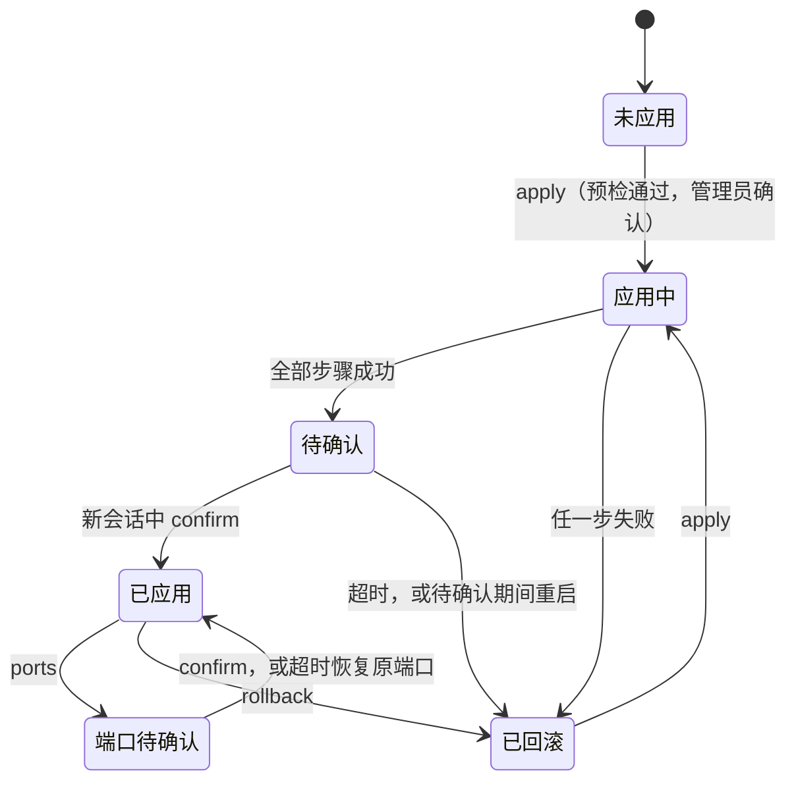

# VPS Hardening 方案设计

| 项目 | 内容 |
|---|---|
| 状态 | v1.6 草案：按需求 v1.10（D47）修改第 7.3 节第 4 步：由本工具安装 fail2ban 时，安装期间临时屏蔽这个服务，第一次启动就使用 FR-08 的值。待用户评审。v1.5 已批准：按需求 v1.9（D41、D43）修改第 7.1、7.3、7.4、8、12 节：`ports` 改为 P0，推荐流程中加固时只放行 22/tcp，安装 3X-UI 时用 `ports` 开放它的端口；预检发现待重启时只警告，不阻止应用。第 10 节 M4 一行记录的是当时的优先级，保持不变。用户于 2026-10-24 评审通过（需求 U28、D44）。v1.4 已批准：按需求 v1.7（D34～D36）修改第 7.6 节验证表的 SSH、UFW 两行：sshd 配置中没有 `Match` 块；不得放行的是 80/tcp；before/after 框架文件与软件包的原始文件相同。UFW 一行原本就要求规则与声明逐条一致，实现中按应用后的记录比对，偏离了这一要求，已在修复中改回。按需求 D37，UFW 一行再增加：`user.rules`、`user6.rules` 与记录的摘要相同。用户于 2026-10-22 评审通过（需求 U25、D39）。需求 v1.8 草案（D40）修复的是实现与已有要求的偏差，不改变本文的方案，本文没有随之修改。v1.3 已批准：按需求 v1.6（D32）把第 7.4 节对 vps-proxy-setup 的要求和第 8 节虚拟机生命周期中的 3X-UI 改为 v3.10.2；第 10 节 M3 一行记录的是当时的版本，保持不变。用户于 2026-10-22 评审通过（需求 U24、D38）。v1.2 已批准：按需求 v1.4（D26）修改第 2、3、8～10 节：正式支持和验证的架构改为 x86_64，aarch64 改为按需运行的参考；第 10 节的 M2、M3 两行按详细设计 v0.3 第 1 节的范围调整修改。用户于 2026-10-20 评审通过（需求 U16、D28）。v1.1 已批准：按需求 v1.3（D22～D24）修改第 2、7～10、12 节：root 只用密钥登录，不创建管理用户；确认改由 root 在新会话中执行；Fail2ban 用 `normal` 过滤模式，`maxretry` 取 5；用户于 2026-10-20 评审通过（需求 U13、D25）。v1.0：用户于 2026-10-13 确认第 11 节的五项建议（需求 U9、D18～D20）。作为详细设计、验证计划和实现的依据，修改需重新评审 |
| 日期 | 2026-10-25（v1.0 为 2026-10-13） |
| 上游 | [需求规格说明 v1.10](requirements.md)（草案） |
| 下游 | 详细设计、[验证计划](verification-plan.md)、实现 |
| 深度 | 高层设计：确定组件、边界、流程和关键机制，不含代码和操作手册 |

**证据状态。** 本文只是设计，仓库里还没有实现，也没有任何运行证据。文中标"已核实"的，是 2026-10-13 对照上游源码、发行版软件包或官方文档核实的结果；标"推断"的，要在实现和虚拟机测试中证实。

## 1. 背景与目标

需求规格说明 v1.0 已经确定要做什么，本文回答怎么做：

- 单命令工具用什么形态实现（D7）；
- 怎样在不依赖发起会话的前提下，做到"待确认 → 超时自动恢复"（FR-05）；
- 每个受管对象写在哪里，怎样验证，怎样回滚；
- 怎样在三个平台上验证（NFR-04），aarch64 作为参考（需求 D26）；
- 给出 OD-4（确认时限）的具体数值。

## 2. 需求摘要

驱动设计的需求：

| 驱动因素 | 需求 | 对设计的影响 |
|---|---|---|
| 不锁死 | FR-05、NFR-02 | 自动恢复必须在第一项影响登录的变更之前就绪，并且独立于 SSH 会话和工具进程；确认必须来自新会话 |
| 只支持新机 | FR-02、D6 | 预检严格拒绝存量主机，换来简单的所有权模型：本工具写的文件都归自己 |
| 不越界 | NFR-08、需求第 7.1 节 | 只写本工具独占的文件；共享文件（UFW 规则文件）只通过官方命令修改，并整体备份 |
| 以最终生效值为准 | FR-04、FR-08、FR-09 | 写入后读取生效值（`sshd -T`、`fail2ban-client get`、`apt-config dump`），而不是检查自己写的文件 |
| 秘密 | NFR-01 | 工具不接收任何秘密：不读取密码，不接收私钥；root 的公钥只记录指纹 |
| 共存 | FR-11、需求第 7.2 节 | verify 要能在安装 3X-UI 之后发现漂移 |

## 3. 约束

| 类型 | 内容 | 来源 |
|---|---|---|
| 已批准 | Debian 12/13、Ubuntu 24.04，x86_64，systemd；aarch64 作为参考：工具允许运行，测试按需执行 | D11、D26、NFR-04 |
| 已批准 | VPS 本机单命令，提供预检、应用、验证、回滚 | D7 |
| 已批准 | 只用官方仓库的软件包 | NFR-05 |
| 已批准 | 发布资产附带 SHA-256，安装前校验 | NFR-07 |
| 已批准 | 不改 vps-tuning 的 17 项 sysctl 和 qdisc，不改 3X-UI 的文件，不改 Fail2ban 主配置 | NFR-08 |
| 沿用的惯例（可以改） | vps-tuning 采用 Bash + ShellCheck、Release 资产 + 校验安装器、QEMU 虚拟机生命周期 CI | vps-tuning 仓库 |
| 资源 | 一人维护三个仓库 | R-9 |

## 4. 候选方案

### 4.1 实现形态

| 候选 | 说明 | 评价 |
|---|---|---|
| A. Bash 工具（推荐） | 一个入口命令加若干模块脚本，直接调用 `sshd`、`ufw`、`fail2ban-client`、`apt-config`、`systemctl` | 与 vps-tuning 同栈，可以复用它的 ShellCheck 工作流、安装器和虚拟机 CI；目标系统不需要额外的运行时。弱点是错误处理和结构化状态全靠纪律 |
| B. Python 3 工具 | 命令面相同，用 Python 实现 | 状态管理和输出解析更稳。但最小化安装不保证有 python3（云镜像因为 cloud-init 通常自带，属推断），而且三个仓库会出现两套语言和测试栈 |
| C. 本机 Ansible（`ansible-playbook -c local`） | 用 Ansible 角色描述目标状态 | 声明式、幂等。但要先在 VPS 上安装 Ansible 及其依赖；"待确认 → 超时恢复"这种跨会话流程不是 Ansible 的原生能力，仍然要自己写 |
| D. 直接采用现成项目 | dev-sec/ansible-collection-hardening、konstruktoid/hardening、ovh/debian-cis | 范围不符。按各项目的自述，它们分别面向 Linux/SSH/nginx/MySQL 的通用加固、Ubuntu 全面加固、PCI-DSS 合规，都远超 D10 的"基础加固"；推断还会改动内核网络参数，与 NFR-08 冲突（未逐项核对）。只作为评审时的对照资料 |
| E. 创建 VPS 时用 cloud-init user-data 加固 | 首次启动就完成加固 | 暴露窗口最短。但取决于服务商是否支持自定义 user-data（未核实，各家不同），没有"新会话确认"环节，与 D7 的形态不符。首版不采用；以后可以只用 user-data 安装本工具，加固仍由管理员登录后执行 |

### 4.2 自动恢复机制（FR-05）

| 候选 | 说明 | 评价 |
|---|---|---|
| A. systemd 临时定时器 + 开机兜底单元（推荐） | 用 `systemd-run --on-active` 创建临时定时器，到时执行回滚；同时启用一个开机单元，只在"待确认"标记存在时执行回滚 | 由 PID 1 托管，与 SSH 会话、终端和工具进程都无关，不需要额外的软件包。临时单元在重启后不会保留，所以重启场景由开机单元补上 |
| B. `at` 作业 | 用 atd 安排回滚 | 要额外安装并常驻 atd；错过时间后开机是否补跑，取决于 atd 的实现（未核实） |
| C. 后台进程 | 用 `setsid`/`nohup` 启动一个"等待后回滚"的进程 | 重启即丢失，还可能被会话清理策略杀掉，不可靠 |
| D. 工具自测 SSH | 工具用临时密钥连回本机，成功就自动确认 | 违反 NFR-01（不生成私钥），也证明不了管理员手里的密钥和外部网络路径可用。不采用 |

### 4.3 配置写入方式

| 对象 | 候选 | 选择 |
|---|---|---|
| sshd | 修改 `sshd_config` 主文件，或写 `sshd_config.d` 下的独立文件 | 独立文件 `00-vps-hardening.conf`。主文件开头的 `Include` 先于其他设置被读取；文件名排在常见镜像片段（如 `50-cloud-init.conf`）之前，按"同一关键字取首个值"的规则覆盖镜像片段（FR-04） |
| UFW | 用 `ufw` 命令，或直接写 `user.rules` | `ufw` 命令。规则文件的格式是 ufw 的内部实现，直接写容易在 ufw 升级后失配 |
| Fail2ban | 修改 `jail.conf`，或写 `jail.d/*.local` 和 `fail2ban.local` | 后者，FR-08 明确要求 |
| 自动更新 | 修改 `50unattended-upgrades`，或写独立的 `apt.conf.d` 文件 | 独立文件。`50unattended-upgrades` 是 conffile，改动后软件包升级会出现配置文件提示，unattended-upgrades 会因此跳过该软件包（需求第 10.1 节） |

### 4.4 回滚方式

| 候选 | 评价 |
|---|---|
| A. 快照恢复（推荐）：第一项变更之前，记录目标文件的内容、属主、权限、摘要，以及相关服务的启用和运行状态；回滚时按快照恢复 | 结果确定，与已经执行了哪几步无关，适合中途失败的部分回滚。新机上这些文件大多还是发行版的初始内容，快照很小 |
| B. 逆操作：按执行日志逐条撤销（例如 `ufw delete`） | 每种操作都要有对应的逆操作；中途失败时状态组合多，容易遗漏 |

软件包不卸载。回滚后保留本工具安装的软件包，把相关服务恢复到应用前记录的状态，并在输出中列出这些软件包。卸载可能连带删掉镜像原有的依赖，风险大于收益。

### 4.5 发布与安装

| 候选 | 评价 |
|---|---|
| A. GitHub Release 资产 + 固定版本的校验安装器（推荐） | 与 vps-tuning 相同：安装器内置 `SHA256SUMS` 的摘要，逐个校验资产，安装时不执行加固 |
| B. `git clone` 后运行 | 要先装 git；运行的是可变分支，不满足 NFR-07 |
| C. 打包成 .deb | 文件归属清晰，但要维护打包和签名；NFR-05 不允许添加第三方软件源，只能手工 `dpkg -i`，相比 A 没有实质收益 |

## 5. 方案比较

实现形态（第 4.1 节）是唯一影响全局的选择，其余各项在第 4 节中已经逐项给出取舍。

| 维度 | A. Bash | B. Python | C. 本机 Ansible |
|---|---|---|---|
| 功能覆盖（FR-01～FR-14） | 全部可以实现 | 全部可以实现 | 全部可以实现，确认流程要自己写 |
| 防锁死（FR-05） | 采用 systemd 机制，与语言无关 | 同左 | 同左，另外要把这段流程放到 playbook 之外 |
| 目标机依赖 | 无（bash 和 coreutils 是基础组件） | python3 | Ansible 及其 Python 依赖 |
| 安全面 | 依赖最少；要防注入（白名单校验、参数分开传递） | 依赖少，解析更稳 | 依赖面最大 |
| 单人维护 | 与 vps-tuning 同栈，复用 CI 和安装器 | 新增一套语言栈 | 新增一套工具链 |
| 解析命令输出 | 较脆弱，要按平台测试固定下来 | 较好 | 模块封装了一部分 |
| 演进 | 以后需要多主机时，可以在外面包一层 Ansible 调用本工具 | 同左 | 天然支持多主机，但 D7 用不到 |
| 可验证性 | 复用 vps-tuning 的虚拟机 CI | 同左 | 同左 |

结论：选 A。B 是可行的退路：如果实现中发现 Bash 的解析和状态管理缺陷多，可以把这两部分换成 Python，命令面不变。

## 6. 推荐方案

推荐组合：Bash 工具 + systemd 临时定时器和开机兜底单元 + 独立配置文件 + 快照回滚 + Release 校验安装器。

**置信度：中高。** 用到的机制都是三个平台自带的组件（systemd、OpenSSH 的 `Include`、ufw、fail2ban 的 `jail.d`、apt 的 `apt.conf.d`），关键行为已经对照源码或官方文档核实。没有给"高"，是因为以下几点还没有运行证据，要在 M1、M2 的虚拟机测试中证实：

- Ubuntu 24.04 的 sshd 采用 socket 激活，重新加载的效果；
- 开机兜底单元的启动顺序；
- 确认时识别"新的 SSH 会话"的方法。

放弃其他方案的原因见第 4 节。

## 7. 架构设计

### 7.1 命令面

命令名为 `vps-hardening`（OI-2，已确认）。

| 子命令 | 作用 | 是否修改系统 | 需求 |
|---|---|---|---|
| `preflight` | 只读预检 | 否 | FR-01、FR-02 |
| `apply` | 交互式应用，结束时进入"待确认" | 是 | FR-03～FR-09、FR-05 |
| `confirm` | 在新的 SSH 会话中以 root 执行，结束"待确认" | 只改工具状态和定时器 | FR-05 |
| `verify` | 只读验证和漂移检测 | 否 | FR-10 |
| `status` | 显示状态、确认截止时间和面板隧道提示 | 否 | FR-13 |
| `rollback` | 手工回滚 | 是 | FR-12 |
| `ports` | 增减代理入站端口和订阅端口，走同样的待确认流程；推荐流程中，安装 3X-UI 时用它开放 3X-UI 的端口（需求 D41） | 是 | FR-14（P0） |

输入：

- 面板端口、公开端口和确认时限由命令行参数提供。工具不接收用户名、公钥或密码：管理账户是 root（需求 D22）；Fail2ban 的 `maxretry` 固定为 5（需求 D23）。
- `apply`、`ports`、`rollback` 必须在交互终端中运行，否则拒绝执行。这也排除了 `curl | bash` 式的误用。
- 预检逐行检查 root 现有的 `authorized_keys`：至少要有一把不带选项、能被 `ssh-keygen -l` 解析、算法被 sshd 接受的公钥，否则拒绝（需求 FR-03）。带选项的行不计入，例如 cloud-init 禁用 root 登录时写入的 `command=` 前缀。
- 面板端口默认 2053（与用户的隧道配置一致），可以修改（需求 D20）。工具记录这个值，供 verify 核对和输出隧道命令；vps-proxy-setup 安装 3X-UI 时把同一个值传给 `XUI_PANEL_PORT`。

### 7.2 文件与对象

| 对象 | 位置 | 归属 | 回滚时 |
|---|---|---|---|
| 入口和模块 | `/usr/local/bin/vps-hardening`、`/usr/local/lib/vps-hardening/` | 本工具 | 保留（卸载另行处理） |
| 状态目录 | `/var/lib/vps-hardening/`（0700）：清单、快照、日志、待确认标记 | 本工具 | 保留，并记录回滚结果 |
| root 的公钥 | root 的 `AuthorizedKeysFile`（默认 `/root/.ssh/authorized_keys`） | 管理员；本工具只读 | 不涉及 |
| sshd 片段 | `/etc/ssh/sshd_config.d/00-vps-hardening.conf` | 本工具独占 | 删除 |
| UFW | `/etc/default/ufw`、`/etc/ufw/` 下的规则文件和 `ufw.conf` | ufw 软件包，经 `ufw` 命令修改 | 按快照恢复，并恢复应用前的启用状态 |
| Fail2ban | `/etc/fail2ban/jail.d/99-vps-hardening.local`、`/etc/fail2ban/fail2ban.local` | 本工具独占 | 删除，并恢复服务状态 |
| 自动更新 | `/etc/apt/apt.conf.d/52vps-hardening` | 本工具独占 | 删除，并恢复定时器状态 |
| 开机兜底单元 | `/etc/systemd/system/vps-hardening-rollback.service`，只在待确认期间启用 | 本工具独占 | 确认或回滚后停用 |
| 临时定时器 | 由 `systemd-run` 创建，位于 `/run`，重启即消失 | 本工具 | 确认时停止 |

文件名的排序依据：

- `00-vps-hardening.conf` 排在常见镜像片段之前，sshd 对同一关键字取首个值。
- `52vps-hardening` 排在 `20auto-upgrades` 和 `50unattended-upgrades` 之后，单值选项取最后一次赋值。来源列表不同：apt 配置中的列表只会追加，不会被后面的文件覆盖，必须先用 `#clear` 清空（已核实，apt.conf(5)）。
- Fail2ban 先读 `jail.d/*.conf`，再读 `jail.d/*.local`，所以 `.local` 中的值会覆盖发行版的 `defaults-debian.conf`。

是否有别的文件排得更前或更后，不靠文件名推断，统一以生效值核对为准（第 7.6 节）。

### 7.3 状态与应用流程

`apply` 的步骤：

1. **预检**（FR-01、FR-02）：任一项不满足就退出，不做任何变更。待重启只报警告，不阻止应用（需求 D43）。
2. **交互确认**：列出将要做的变更；管理员确认已保留当前会话、服务商控制台可用（FR-05）。
3. **记录初始状态**：各软件包是否已安装，相关服务的启用和运行状态。
4. **安装软件包**：`ufw`、`fail2ban`、`nftables`、`python3-systemd`、`unattended-upgrades`。这一步不改变登录路径：ufw 安装后不会自行启用；fail2ban 的安装脚本会按发行版默认配置启动服务（Debian 12 上可能因为没有 `auth.log` 而启动失败）。这期间的封禁只有默认的 10 分钟，第 8 步重启后仍按 10 分钟恢复（详细设计第 8.8 节）。所以由本工具安装 fail2ban 时，安装期间临时屏蔽这个服务（只在运行期有效，重启即消失），第一次启动在第 8 步，使用 FR-08 的值（需求 D47）。
5. **快照**目标文件。
6. **布置自动恢复**：写待确认标记，其中记录发起会话的审计会话编号，供 `confirm` 区分新旧会话（第 7.5 节）；启用开机兜底单元；创建临时定时器。三者都成功之后，才开始第一项影响登录的变更。
7. **SSH**：写片段 → `sshd -t` → 用 `sshd -T -C` 分别以 root 和被禁止的镜像用户评估磁盘上的配置，不符合 FR-04 就删除片段并终止 → 让 sshd 重新读取配置。
8. **UFW 和 Fail2ban**：UFW 设置默认策略，放行 22/tcp 和声明的公开端口，最后启用；Fail2ban 写入两个配置文件 → `fail2ban-client -t` → 启用并重启服务 → 核对生效值。
9. **自动更新**：写配置文件，核对 `apt-config dump` 和定时器状态。
10. **进入待确认**：把定时器重新计为完整时限；输出截止时间、新会话中要执行的确认命令和面板隧道命令。`apply` 随即退出，不等待。

任何一步失败，都立即执行同一套回滚逻辑，并以非零状态退出（FR-05）。

再次执行 `apply`：

- 状态为"已应用"且 verify 全部通过时，不做任何变更，退出码为 0（NFR-03）。
- 有漂移时拒绝执行，提示先回滚或人工处理（FR-02）。
- 上次应用失败并已回退时（状态为"已回滚"），按正常流程再次应用。

### 7.4 各模块设计要点

#### 管理账户与免密 sudo 账户（FR-03）

- 管理账户是 root（需求 D22）。工具不创建账户，不改 sudoers，也不改 root 的 `authorized_keys`；预检确认 root 至少有一把可用的公钥（第 7.1 节）。
- 预检扫描每个有有效登录 shell 且有 `authorized_keys` 的非 root 账户，执行 `sudo -l -U`。有免密规则的账户（典型的是 cloud-init 创建的镜像默认用户）写入 sshd 的 `DenyUsers`（D13），它的 sudo 规则不动。不改 sudoers 的理由：一旦出现语法错误，所有 sudo 都会失效，风险大于收益。

#### SSH（FR-04）

- 片段只写 FR-04 表中的四项认证选项，以及 D13 需要的 `DenyUsers`。`AllowTcpForwarding` 保持发行版默认值 `yes`，只核对，不写入。
- `PermitRootLogin` 写为 `prohibit-password`（需求 D22）。`sshd -T` 把这个值显示为 `without-password`（M1 在三个平台镜像的默认值上观察到，详细设计第 8.1 节），verify 两种写法都接受。
- 预检确认主配置中的 `Include /etc/ssh/sshd_config.d/*.conf` 位于所有相关设置之前；如果镜像改过主配置，导致片段无法生效，预检失败。
- 重新加载之前，先用 `sshd -T -C` 读取磁盘配置的生效值，不符合就不加载。
- Ubuntu 24.04 的 OpenSSH 默认采用 systemd socket 激活（已核实，noble 的 openssh 变更日志），具体的重新加载方式在详细设计中确定，并在虚拟机中验证。端口不变，所以不需要重新生成 socket 配置。
- 已经建立的 SSH 连接不受重新加载影响（推断，测试中确认），所以发起会话在待确认期间始终可用。

#### UFW（FR-06）

- 只用 `ufw` 命令设置默认策略（拒绝入站、允许出站、拒绝转发），放行 22/tcp 和声明的公开端口。每条规则带固定注释，方便 verify 区分规则的来源。推荐流程中加固时不声明公开端口，只放行 22/tcp；3X-UI 的端口在安装 3X-UI 时用 `ports` 开放（需求 D41）。
- 地址族按声明处理：双栈用不限定地址的规则；只开一个地址族时，把目的地址限定为 `0.0.0.0/0` 或 `::/0`（具体语法在详细设计中按 ufw 0.36.2 核实）。
- 启用前再次确认 22/tcp 的放行规则已经写入（FR-05）。
- 三个平台都是 ufw 0.36.2 系列（Debian 12 为 0.36.2-1，Debian 13 为 0.36.2-9，Ubuntu 24.04 为 0.36.2-6，已核实）。verify 的解析仍按平台分别测试。
- 不修改 `/etc/ufw/sysctl.conf`（需求第 7.3 节）。

#### Fail2ban（FR-08）

- 显式安装 `fail2ban`、`nftables`、`python3-systemd`。在 Ubuntu 24.04 上，预检要求 fail2ban 的候选版本不低于 `1.0.2-3ubuntu0.1`，也就是 noble-updates 已经启用；否则拒绝并说明原因。
- `jail.d/99-vps-hardening.local` 写入 FR-08 表中 sshd jail 的全部值，其中 `mode = normal`、`maxretry = 5` 都是固定值，不是参数（需求 D23）；`fail2ban.local` 只写 `dbpurgeage = 30d`。
- 不改 `jail.conf` 和 `fail2ban.conf`：verify 用应用时记录的摘要核对，并以 `dpkg --verify` 辅助。
- 显式的 `backend = systemd` 和带 `sshd-session` 的 `journalmatch`，同时覆盖 Debian 12 没有 `auth.log`、Debian 13 默认 `journalmatch` 不含 `sshd-session` 两种情况（已核实：Debian 13 的 `defaults-debian.conf` 把 `journalmatch` 覆盖成了不含 `sshd-session` 的值）。
- `nftables.service` 保持不启用。Debian 12/13 的 nftables 软件包默认不启用该服务，它的默认配置第一条就是 `flush ruleset`（已核实）。一旦被启用，开机时可能清掉 UFW 和 Fail2ban 写在 nftables 中的规则（推断，取决于启动顺序）。Ubuntu 沿用同一打包，未单独核实。
- FR-08 中的手工封禁和真实触发都放在测试里做，不放进 apply，也不放进只读的 verify。

#### 自动安全更新（FR-09）

- 独立文件设置 `APT::Periodic::Update-Package-Lists "1"`、`APT::Periodic::Unattended-Upgrade "1"` 和 `Unattended-Upgrade::Automatic-Reboot "false"`。
- 先清空 `Unattended-Upgrade::Origins-Pattern` 和 `Unattended-Upgrade::Allowed-Origins`（unattended-upgrades 两个列表都读，已核实 2.12 源码），再写入 FR-09 规定的来源（需求 D19）：
  - Debian：`Debian-Security` 标签的安全来源，以及 `label=Debian` 的稳定版小版本更新；
  - Ubuntu：`<代号>-security`，另外保留 ESM 的两个安全来源（不附加 Ubuntu Pro 时不起作用）。
- 与发行版默认值相比（已核实）：
  - Debian 与默认值相同。仍然显式写入，是为了让生效值不依赖镜像对 `50unattended-upgrades` 的改动；
  - Ubuntu 去掉了发布仓库本身。发布仓库在版本发布后不再变化，去掉它实际没有影响。

#### 面板隧道（FR-07）

- 本工具不碰面板：不放行面板端口，也不改 3X-UI。
- `apply`、`confirm` 和 `status` 输出隧道命令模板：本地只绑定 `127.0.0.1`；用 root 登录，指定私钥，带上 `IdentitiesOnly=yes` 和 `ExitOnForwardFailure=yes`；不使用 `-g` 或 `0.0.0.0`。使用说明中另外给出写进 Windows `~/.ssh/config`（`LocalForward`）的写法。
- verify 发现 `x-ui.service` 后检查：面板端口只在回环地址上监听。监听在 `0.0.0.0`、`::` 或公网地址上时判为不符合。这一层由 vps-proxy-setup 设置，本工具只核对。
- 对 vps-proxy-setup 的要求：安装 3X-UI 后必须执行 `x-ui setting -listenIP 127.0.0.1` 并重启 x-ui。v3.10.2 与 v3.7.0 相同：只有在交互安装、并且选择不配证书时，才会询问是否绑定回环；非交互安装会强制不绑定（已核实两个版本的 `install.sh`）。
- 对 vps-proxy-setup 的另一条要求（需求 D32，替代 D21）：安装时带版本参数 `v3.10.2`。v3.10.2 的 `install.sh` 从同一 tag 下载菜单脚本，所以不再需要 D21 中"用 tag 中的 `x-ui.sh` 替换 `/usr/bin/x-ui`"这一步。

### 7.5 防锁死与确认（FR-05）

**布置顺序。** 先写待确认标记，再启用开机兜底单元，最后创建临时定时器。三者都成功，才开始改 SSH。

**确认时限（OD-4，已定为需求 D18）：默认 10 分钟，允许 3～60 分钟。**

- 下限 3 分钟：在 Windows 上新开终端、以 root 用密钥登录并执行确认，正常情况下一两分钟就能完成，3 分钟留出余量。
- 默认 10 分钟：留出排查密钥路径、`~/.ssh/config` 写错等常见问题的时间。代价是，如果真的被锁在外面，最多要等 10 分钟才会自动恢复。
- 上限 60 分钟：再长，主机就会长时间处在新旧配置都可能生效的中间状态。
- 置信度：中。依据是对操作步骤的估计，不是测量数据；真实主机验收后可以调整。

**确认的条件。** 在新会话中以 root 执行 `vps-hardening confirm`，必须同时满足：

- 当前状态是待确认；
- 当前进程的登录 UID（`/proc/self/loginuid`）为 0，即这个会话是以 root 身份登录的。这个值由 `pam_loginuid` 在登录时写入，sudo 和 su 都不会改变它（Debian 12 的 sshd PAM 配置包含 `pam_loginuid`，已核实）。所以从其他账户经 sudo 或 su 确认是行不通的；
- 当前进程的审计会话编号（`/proc/self/sessionid`，同样在登录时分配）与发起 `apply` 的会话不同。原会话和新会话的登录 UID 都是 0，只能靠会话编号区分（推断，M2 在虚拟机中核实，见 DR-11）；
- 会话来自 sshd，而不是控制台。具体判定方法在详细设计中确定。

这些检查防的是误操作，不是防有意绕过的 root。新会话能登录进来，就证明了新配置下 root 的密钥登录可用。

**确认之后。** 停止临时定时器，停用开机兜底单元，删除标记，记为"已应用"，并运行一次 verify。

**超时。** 临时定时器启动回滚服务，按快照恢复。

**待确认期间重启。** 开机兜底单元在 sshd、UFW、Fail2ban 启动之前恢复文件，让它们以应用前的配置启动；服务的启用状态在启动完成后恢复。这里选择"开机立即回滚"，而不是"开机后重新计时"：待确认期间发生重启，最常见的原因就是管理员已经被锁在外面，只好从控制台重启，此时最需要的就是恢复原来的登录方式。

**互斥。** `apply`、`confirm`、`rollback` 和 `ports` 共用一把锁。应用阶段调用的外部命令都设超时，保证应用在确认时限内结束或失败。

不锁 root，不改 root 密码，不禁用控制台登录（FR-05）。

### 7.6 只读验证（FR-10）

| 区域 | 检查 | 级别 |
|---|---|---|
| 工具状态 | 状态为"已应用"；待确认时报告剩余时间 | 待确认时为警告 |
| root 的公钥 | 至少有一把可用的公钥（与预检相同的判定） | 不符合 |
| 其他账户 | 每个可经 SSH 登录的非 root 账户都没有免密 sudo，或者已在 `DenyUsers` 中 | 不符合 |
| SSH | 分别以 root 和被禁用户执行 `sshd -T -C`，结果满足 FR-04；主配置和它包含的文件中没有 `Match` 块（需求 D36）；片段摘要未变；22 端口在 IPv4 和 IPv6 上监听 | 不符合 |
| UFW | 已启用；默认策略符合要求；`IPV6=yes`；规则集合与声明逐条一致，没有多余规则（包括不带工具注释的规则）；没有面板端口和 80/tcp 的规则（需求 D35）；before/after 框架文件与软件包的原始文件相同（需求 D34）；`user.rules`、`user6.rules` 与应用和端口变更记下的摘要相同，直接写入、`ufw status` 不显示的规则由此发现（需求 D37） | 不符合 |
| Fail2ban | 配置检查通过；服务启用且运行；只有 `sshd` 一个 jail，没有 `3x-ipl`；生效值等于 FR-08 表；`jail.conf` 和 `fail2ban.conf` 未改动 | 不符合 |
| nftables | `nftables.service` 未启用 | 不符合 |
| 自动更新 | `apt-config dump` 中的三个值；两个 APT 定时器启用且运行；来源列表与 FR-09 一致 | 不符合 |
| 边界 | 安装了 3X-UI 时：面板端口只在回环地址上监听；`/etc/sysctl.d/99-bbr-x-ui.conf` 不存在。没有 Docker | 不符合 |
| 待重启 | `/var/run/reboot-required` 存在 | 警告 |

- 输出逐项结果，不输出秘密；有不符合项时退出码非零。
- verify 只调用读取类命令。来源列表直接从 `apt-config dump` 读取，不执行 `unattended-upgrade --dry-run`，因为后者会写日志文件；dry-run 放在测试中作为 FR-09 的验收。

### 7.7 状态记录（FR-13）

- 清单内容：工具版本；每次操作的时间（UTC）；输入参数（端口、时限）；发起 `apply` 的审计会话编号；每个目标文件变更前后的摘要；软件包和服务的初始状态；root 的公钥只记录指纹。
- 格式：行式纯文本（键值对），Bash 读写方便，人也能直接看，不引入 jq 等额外依赖。
- 权限：目录 0700，文件 0600，属主 root。
- 工具从不读取密码，不开启 shell 跟踪（`set -x`）。

### 7.8 安全设计

| 方面 | 设计 |
|---|---|
| 信任边界 | 工具以 root 身份在 VPS 上运行。输入来自管理员，但仍逐项校验（端口范围和冲突）；root 的 `authorized_keys` 逐行解析，不可用的行不计入；软件包来自发行版的签名仓库；工具本身经安装器校验 |
| 认证 | 登录只剩密钥一种方式，root 是管理账户（需求 D22）；访问面板之前多一层 SSH 认证 |
| 注入 | 外部输入在使用前按白名单校验；调用外部命令时参数分开传递，不拼接 shell 字符串 |
| 秘密 | 见第 7.7 节和 NFR-01 |
| 审计 | 状态目录记录每次操作；系统日志中的 sudo、sshd、fail2ban 记录保持发行版默认 |
| 供应链 | 安装器内置清单摘要，逐个校验资产；不回退到可变分支或 `latest`（沿用 vps-tuning） |
| 残余风险 | 管理员把自己封掉（R-3）：已改用 `normal` 过滤模式（需求 D23），建议客户端使用 `IdentitiesOnly=yes`，并通过真实触发测试评估。root 私钥泄露即失去主机（R-11，用户接受）。云端安全组不受本工具控制（R-8） |

### 7.9 发布与安装

沿用 vps-tuning 的做法：GitHub Release 资产 + 固定版本的安装器。安装器内置 `SHA256SUMS` 的摘要，逐个校验资产后安装到 `/usr/local`，只安装、不执行加固。首个可用版本以预发行版（rc）发布，真实主机验收（M5）通过后再发布正式版。

## 8. 验证设计

本节是验证计划的框架，具体用例在验证计划中展开。

| 层次 | 内容 |
|---|---|
| 静态检查 | ShellCheck（复用 vps-tuning 的工作流）；扫描仓库中的真实地址和秘密 |
| 虚拟机生命周期 | 复用 vps-tuning 的 QEMU 方案：3 个平台的 x86_64 各一组；aarch64 的 3 组按需运行，只作参考（需求 D26），使用 GitHub 的 arm 运行器。官方云镜像按摘要校验。流程：预检 → 应用 → 新会话确认 → 验证 → 重启 → 验证 → 安装 3X-UI v3.10.2（固定 commit `608ef4e`，需求 D32；按需求第 7.2 节的约定，安装后设为只监听回环）→ 验证 → 回滚。与 3X-UI 共存的用例按推荐流程：加固时不声明公开端口，安装 3X-UI 后用 `ports` 开放它的端口并确认（需求 D41） |
| 交互 | 用伪终端驱动确认提示（vps-tuning 的测试已经这样做） |
| 负面用例 | 不确认时自动恢复；发起会话断开；待确认期间重启；root 没有可用公钥（包括只有带 `command=` 的行）；端口冲突；存量主机的四种情形；cloud-init 预置 `PasswordAuthentication yes`；镜像默认用户有免密 sudo；从发起 `apply` 的原会话尝试确认；从其他账户经 sudo 尝试确认；3X-UI 防火墙菜单和 IP Limit 造成的漂移 |
| 外部探测 | 从宿主机经 QEMU 端口转发探测：22/tcp 全程可达；面板端口不可达；经隧道可达。经端口转发进入虚拟机的连接，源地址是 QEMU 用户网络的网关地址，不是回环地址，所以受 UFW 约束（推断，测试中确认） |
| 第二来源 | Fail2ban 真实触发和失败登录用例，从虚拟机内的独立网络命名空间发起（经 veth 接口，使用文档保留地址），避免封掉测试驱动自己的来源。Debian 13 的 OpenSSH 默认启用 `PerSourcePenalties`，也会惩罚失败来源，同样需要这样隔离 |
| 真实主机 | 需要用户另行授权；虚拟机证据不能代替真实主机验收（需求第 12 节） |

确认超时用例使用允许的最小时限（3 分钟），不为测试增加隐藏开关。

## 9. 风险与缓解

| 编号 | 风险 | 影响 | 缓解 | 关联 |
|---|---|---|---|---|
| DR-1 | 自动恢复没有触发（定时器创建失败、回滚逻辑出错） | 锁在服务器外 | 布置失败就终止，不做变更；超时回滚与失败回退共用同一套逻辑，并在三个平台上测试；服务商控制台兜底 | R-1 |
| DR-2 | 开机兜底单元顺序不对，sshd 或 UFW 先以新配置启动 | 重启后的一段时间内仍是新配置 | "待确认期间重启"用例在三个平台上测试 | FR-05 |
| DR-3 | 其他片段或主配置覆盖了本工具的设置 | 加固没有生效，或者误报 | 一律以 `sshd -T`、`fail2ban-client get`、`apt-config dump` 的生效值为准，不符合就终止 | FR-04、FR-08、FR-09 |
| DR-4 | Ubuntu 24.04 socket 激活下，重新加载的效果与预期不同 | 新配置没有生效，或 sshd 中断 | 虚拟机测试；测试期间从外部持续探测 22/tcp | FR-04、NFR-02 |
| DR-5 | `ufw`、`sudo -l`、`fail2ban-client` 的输出格式随版本变化 | verify 误报或漏报 | 按平台固定测试；版本变化时测试先失败 | FR-10 |
| DR-6 | Bash 实现缺陷多 | 维护成本高 | 严格模式、模块化、ShellCheck、生命周期测试；退路是把状态和解析部分换成 Python（第 5 节） | R-9 |
| DR-7 | Debian 13 的 OpenSSH 10.0 把认证拆到新的 `sshd-auth` 进程，发布说明称部分日志会改由 `sshd-auth` 发出（已核实）。而 Debian 13 的 fail2ban 1.1.0-8 中，sshd 过滤器的进程名只匹配 `sshd` 和 `sshd-session`（已核实）。`journalmatch` 中的 `_SYSTEMD_UNIT=ssh.service` 一项按"或"组合，能收进这些日志（推断）；但过滤器的行首前缀可能匹配不上 | Debian 13 上部分失败登录不被计数，Fail2ban 少封或不封 | 上游没有找到相关问题报告。以 FR-08 的真实触发测试为准；确认存在问题时，改写过滤器参数需要重新评审 FR-08 | FR-08 |
| DR-8 | Ubuntu 上 fail2ban 属于 universe 仓库。它的修复版本发布在 noble-updates，而不是 noble-security（已核实）；Canonical 只对附加 Ubuntu Pro 的主机承诺 universe 软件包的安全维护（已核实，Ubuntu ESM 页面） | 只装安全更新时，fail2ban 的后续修复不会自动安装 | 首版不处理（OI-4，已确认） | R-7 |
| DR-9 | 只装安全来源，会错过 Debian 通过小版本发布修复的低危漏洞（Debian 安全团队把这类问题标为 `no-dsa`，不发安全公告，可能在小版本更新中修复，已核实 Debian 安全追踪器说明） | 低危漏洞的修复滞后 | 已处理：Debian 同时自动安装稳定版小版本更新（需求 D19） | FR-09 |
| DR-10 | `nftables.service` 被启用，开机时执行 `flush ruleset` | UFW 和 Fail2ban 的规则被清空 | verify 检查（第 7.6 节） | FR-06、FR-08 |
| DR-11 | 用审计会话编号区分新旧 root 会话（第 7.5 节）的做法不成立，例如内核没有分配会话编号 | 无法确认，或者原会话也能确认 | M2 在 6 组平台上核实；不成立时在详细设计中改用其他判定方法（例如 sshd 进程关系或 logind 会话），并提交评审 | FR-05 |

需求中的 R-2（3X-UI 版本漂移）、R-5（待重启累积）、R-8（云端安全组）仍然有效，处理方式不变；R-3（把自己封掉）的处理按需求 D23 调整；R-11（root 私钥泄露）由用户接受。

## 10. 里程碑

不给日期（单人维护，缺少估算依据），只给顺序和退出条件：

| 里程碑 | 内容 | 退出条件 |
|---|---|---|
| M0 | 评审本设计，确定 OD-4、OI-1～OI-4 | 用户确认（2026-10-13 已完成） |
| M1 | 只读部分：命令骨架、`preflight`、`verify`、ShellCheck；虚拟机测试框架在 6 组平台上跑通 | 干净镜像上预检通过，verify 如实报告"未加固"；执行前后状态摘要一致 |
| M2 | 核心应用：SSH（root 只用密钥、禁止免密 sudo 账户登录）、UFW、待确认与自动恢复、`confirm`；Fail2ban 和自动安全更新的配置写入（提前自 M3，见详细设计第 1 节）；使用说明写明加固前的升级顺序（需求 D24） | 生命周期主流程和防锁死负面用例在三个平台的 x86_64 上通过（aarch64 只作参考，需求 D26） |
| M3 | Fail2ban 生效值的核对、自动安全更新的 dry-run 验证、与 3X-UI v3.7.0 共存 | FR-08 的 11 步验证、FR-11 的共存流程通过 |
| M4 | P1 部分：手工回滚、状态记录、端口变更；发布预发行版 | FR-12～FR-14 验收通过；NFR-07 公开下载回验 |
| M5 | 真实主机验收（需要用户单独授权） | 用户确认后发布正式版 |

## 11. 待决事项

以下五项的建议已由用户于 2026-10-13 确认（需求 U9），目前没有待决事项。

| 编号 | 事项 | 原建议 | 结论 | 影响 |
|---|---|---|---|---|
| OD-4 | 确认时限的默认值 | 默认 10 分钟，范围 3～60 分钟（第 7.5 节），置信度中 | 采用（需求 D18） | FR-05、需求第 6 节 |
| OI-1 | 面板端口的默认值 | 2053，与用户的隧道配置一致，可以修改 | 采用（需求 D20） | FR-07 |
| OI-2 | 命令名 | `vps-hardening`：与仓库同名，一看就懂。这个命令很少输入，不需要像 `dvt` 那样短 | 采用 | 文档、安装器 |
| OI-3 | Debian 是否同时自动安装稳定版小版本更新（`label=Debian`） | 采用：这是 Debian 的默认做法，能自动拿到 `no-dsa` 类低危修复；代价是会自动装上非安全的稳定版修订。置信度：中 | 采用，FR-09 已修改（需求 D19） | FR-09 |
| OI-4 | Ubuntu 上 fail2ban 的后续更新 | 首版不处理；是否附加 Ubuntu Pro 由用户自行决定，不纳入本工具 | 首版不处理。原建议中"verify 在 fail2ban 有可用升级时报警告"是需要另行同意的可选项，这次没有单独确认，暂不纳入 | R-7、FR-09 |

## 12. 需求追踪

| 需求 | 设计章节 |
|---|---|
| FR-01、FR-02 | 7.1；7.3 第 1 步 |
| FR-03 | 7.1；7.4 管理账户与免密 sudo 账户 |
| FR-04 | 4.3；7.4 SSH |
| FR-05 | 4.2；7.3；7.5 |
| FR-06 | 7.4 UFW |
| FR-07 | 7.4 面板隧道 |
| FR-08 | 7.4 Fail2ban；DR-7 |
| FR-09 | 7.4 自动安全更新；OI-3（需求 D19） |
| FR-10 | 7.6 |
| FR-11 | 7.4 面板隧道；8 |
| FR-12 | 4.4；7.2 |
| FR-13 | 7.7 |
| FR-14 | 7.1；7.3；7.4 UFW；8 |
| NFR-01 | 7.4；7.7；7.8 |
| NFR-02 | 7.5；8 |
| NFR-03 | 7.3（再次执行 `apply`） |
| NFR-04 | 8 |
| NFR-05 | 7.4（只装官方仓库的软件包） |
| NFR-06 | 7.4 面板隧道；7.5 |
| NFR-07 | 4.5；7.9 |
| NFR-08 | 7.2；7.4 |
